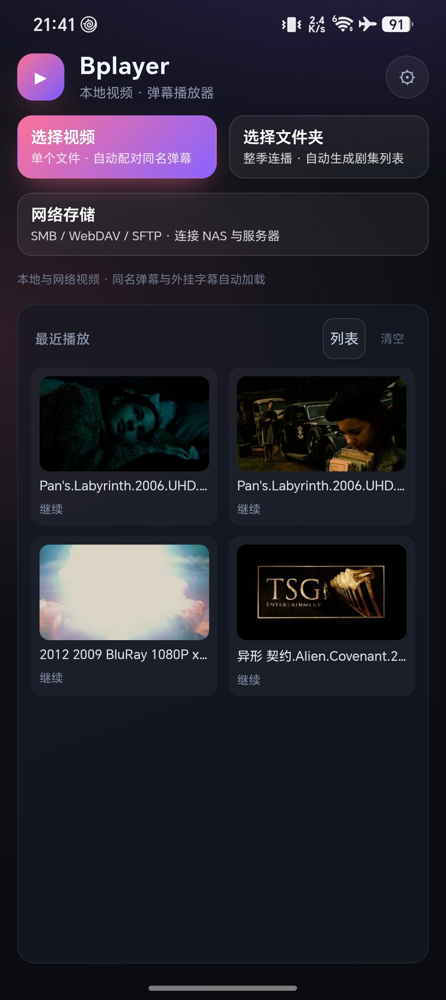
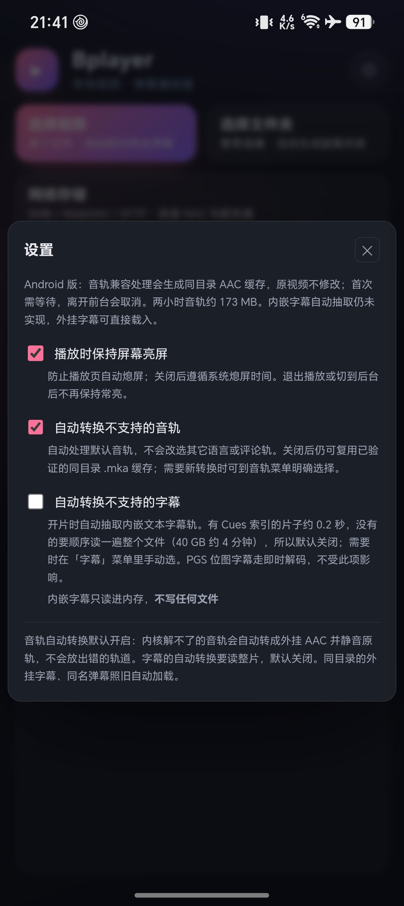
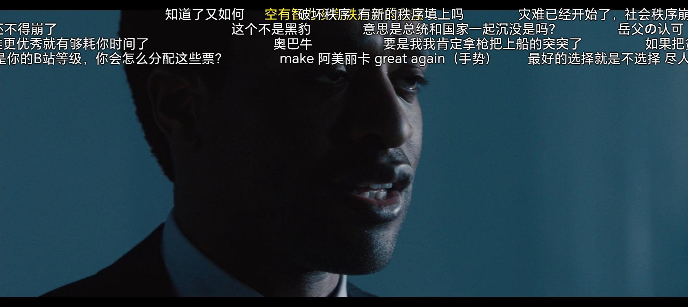

# android-danmuku-video-player

把 Windows 版 Bplayer 移植到 Android：本地与网络存储视频播放，带弹幕与外挂字幕。

<p align="center">
  
  
</p>

<p align="center">
  
</p>

<p align="center">
  
</p>

## 功能

- 直连 SMB / WebDAV / SFTP 播放，不需要先下载整片
- B 站 XML 与 JSON 弹幕，同目录自动配对，也能手动选任意位置的文件
- 外挂字幕（SRT / VTT / ASS / SSA）即时载入，支持时间偏移与字号、颜色、描边、位置
- WebView 解不了的音轨（DTS / TrueHD / AC-3 / E-AC-3）转成 AAC，缓存写在视频同目录，原视频不动
- 折叠屏展开与折叠时自动重排，播放不中断

## 运行要求

- Android 8.0（API 26）及以上，arm64
- 系统 WebView

## 构建

需要 JDK 21、Android SDK、NDK `28.2.13676358`、Node 24。

```bash
cd bplayer-android
npm install
npm run android:build
```

产物：`bplayer-android/src-tauri/gen/android/app/build/outputs/apk/universal/debug/app-universal-debug.apk`

## 许可证

MIT。音轨转换通过 ffmpeg-kit-min 使用 FFmpeg，该部分为 LGPL-3.0-or-later。
