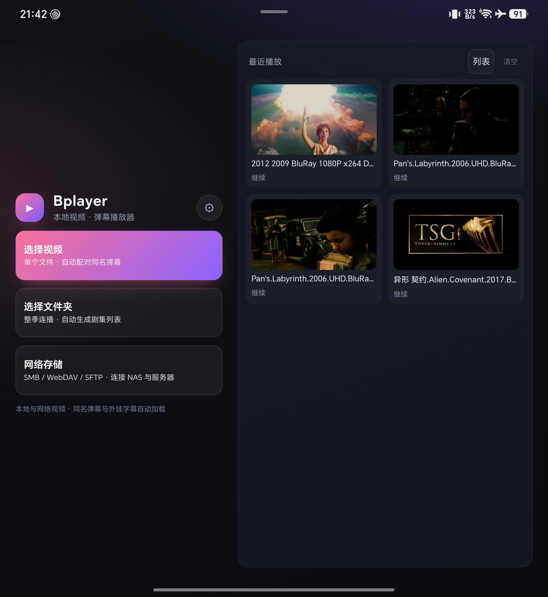

# android-danmuku-video-player

把 [Windows 版 Bplayer](https://github.com/tiny-andr/danmuku-video-player) 移植到 Android：本地与网络存储视频播放，带弹幕与外挂字幕。播放内核是 libmpv。

<p align="center">
  
  
</p>

<p align="center">
  
</p>

<p align="center">
  
</p>

## 功能

- 直连 SMB / WebDAV / SFTP 播放，不需要先下载整片
- B 站 XML 与 JSON 弹幕，同目录自动配对，也能手动选任意位置的文件
- 外挂字幕（SRT / VTT / ASS / SSA）即时载入；内嵌文本与 PGS 位图字幕由 libmpv + libass 直接渲染，ASS 特效保留
- libmpv（mpv 0.42）原生解码：DTS / TrueHD / AC-3 / E-AC-3 直接解码，不转码、不落盘，原视频不动
- 折叠屏展开与折叠时自动重排，播放不中断

## 运行要求

- Android 8.0（API 26）及以上，arm64
- 系统 WebView（只承载界面与弹幕；解码、音频与字幕渲染都在 libmpv 里）

## 构建

需要 JDK 21、Android SDK、NDK `28.2.13676358`、Node 24。

libmpv 的 AAR（约 49 MiB）不在仓库里，首次构建前先拉取：

```powershell
pwsh -NoProfile -File bplayer-android/scripts/fetch-libmpv.ps1
```

脚本固定上游 v1.1.0 的下载地址并校验 SHA256，已存在且校验通过时直接跳过。AAR 的来源、版本、ABI 裁剪与许可证细节见 `research/libmpv-integration.md`。

```bash
cd bplayer-android
npm install
npm run android:build
```

产物：`bplayer-android/src-tauri/gen/android/app/build/outputs/apk/universal/debug/app-universal-debug.apk`

## 许可证

GPL-3.0-or-later，Copyright (c) 2026 tiny-andr。

分发的 APK 里含预编译的 libmpv（`dev.jdtech.mpv:libmpv:1.1.0` 的 AAR）。它的 `libmpv.so` 链接了 GPL 版 FFmpeg（9.0.2，`--enable-gpl --enable-version3`），上游据此声明该二进制的实际许可证是 GPL-3.0-or-later；把这份二进制打进安装包的整包也必须按 GPLv3 分发，所以本仓库整体采用 GPL-3.0-or-later。分发二进制时请同时提供本仓库源码与 GPLv3 全文（见 `LICENSE`）。
